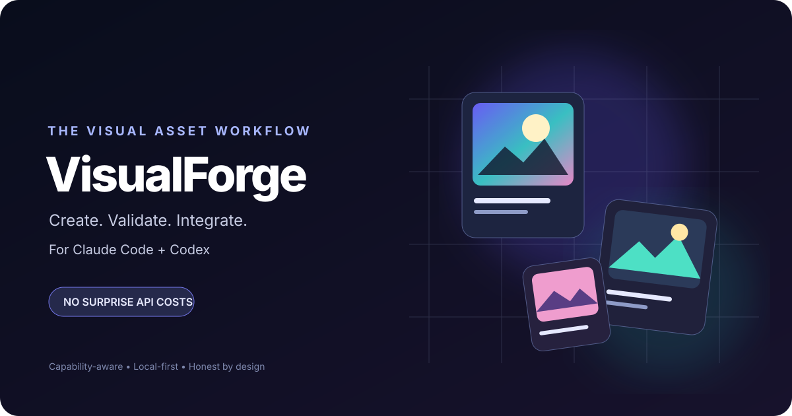

# VisualForge
<p align="center">
  
</p>

> **A visual asset pipeline for coding agents. Zero paid image API required.**

VisualForge helps Claude Code and OpenAI Codex create, edit, organize, and integrate visual assets into real projects using the capabilities already available to the developer: a host-provided image tool, a local image-generation backend such as ComfyUI, or deterministic code-native graphics when raster generation is unavailable.

It is designed around a simple promise: **never pretend an image was generated, never silently incur a paid API cost, and always leave usable files in the project.**

## What makes it different

Most image-generation workflows focus on one model or backend. VisualForge is a **capability-aware asset workflow**:

1. **Detect** what the current environment can actually do.
2. **Route** to an available, authorized backend without inventing credentials or assuming a paid endpoint.
3. **Create** assets from a brief with aspect ratio, style, output path, and edit constraints.
4. **Validate** that output files exist, have plausible formats and dimensions, and do not overwrite existing files unexpectedly.
5. **Integrate** assets into the app, including updating references when asked.
6. **Report** which backend was used, what was created, and any limitations.

No skill can guarantee unlimited free generation: native tools may have plan limits, and local generation needs compatible hardware and model downloads. VisualForge avoids a separate paid image API by default and asks before any cost-bearing or large-download step.

## Capabilities

- Project-aware image briefs for hero images, illustrations, product mockups, textures, thumbnails, and game assets.
- Backend routing: host-provided image tools first when available; configured local backends next; code-native SVG/CSS/canvas assets as an honest fallback.
- Editing and variation workflows that preserve specified visual invariants.
- Safe output paths, collision avoidance, and basic file validation.
- Asset manifest with prompts, dimensions, backend, and source notes when practical.
- Accessibility-aware integration guidance for alt text, responsive images, and loading behavior.
- No hidden API keys, no surprise billing, no silent overwrite.

## Quick start

### Claude Code

Copy `skills/visualforge/` into your project at `.claude/skills/visualforge/`.

### OpenAI Codex

Copy `skills/visualforge/` into your project at `.agents/skills/visualforge/`.

Then ask your agent:

> Use VisualForge to create a 16:9 editorial hero illustration for this project. Inspect the existing visual style, use an available no-extra-API-cost image backend if one exists, save the result under `public/images/`, and tell me exactly which backend you used.

The agent must follow the skill's actual host/tool capabilities. Copying the skill does not install an image model or grant image-generation access by itself.

## Example requests

- “Create three visual directions for the homepage hero, but don't overwrite any existing files.”
- “Edit this product image to use a transparent background while preserving the product shape.”
- “Make a cohesive set of six onboarding illustrations and record the prompts in an asset manifest.”
- “If raster generation isn't available, create a polished SVG illustration instead and tell me it is SVG, not AI-generated raster art.”
- “Audit the images in this app and replace broken references only after showing me the proposed changes.”

## Repository structure

```text
visualforge/
├── README.md
├── LICENSE
├── CONTRIBUTING.md
├── CHANGELOG.md
├── skills/visualforge/SKILL.md
├── skills/visualforge/references/
│   ├── backend-routing.md
│   └── asset-quality-checklist.md
├── examples/
│   ├── prompts.md
│   └── asset-manifest.example.json
├── scripts/validate_assets.py
└── assets/hero.svg
```

## Principles

- **Honest capability detection:** never claim a backend or feature exists unless the environment confirms it.
- **No surprise costs:** do not call paid APIs or download large models without explicit approval.
- **User-owned output:** save generated assets into the requested project path.
- **Safe edits:** preserve originals and avoid overwriting unless the user explicitly requests it.
- **Traceability:** record enough information to reproduce or revise work when possible.
- **Rights-aware use:** follow model and source licenses; don't imitate a living artist's style on request; don't remove provenance or watermarks from third-party assets.

## License

MIT. See [LICENSE](LICENSE).
